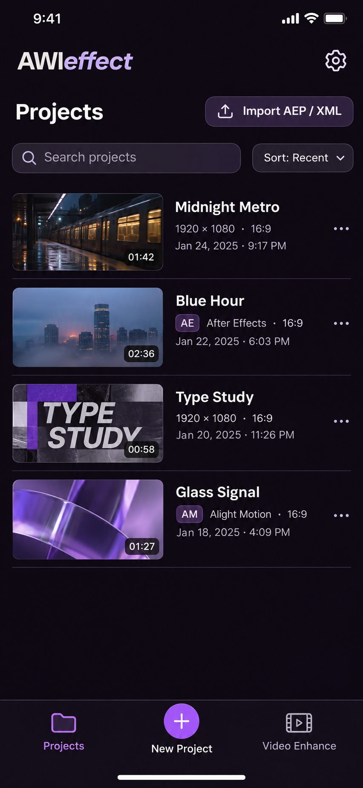
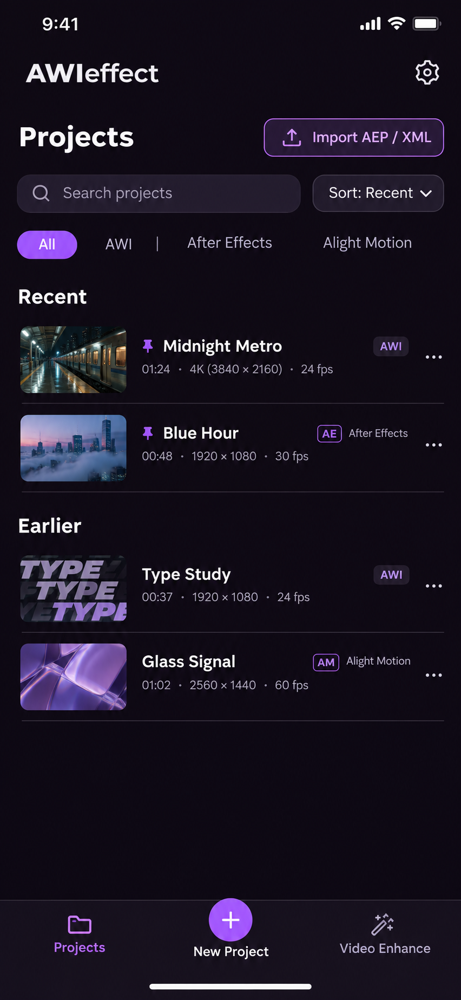

# AWIeffect handoff for Claude

## Start here

- Repo: [thedatthing123-png/AWIeffect](https://github.com/thedatthing123-png/AWIeffect), branch `feat/home-library`. Base app commit `e594147` on `feat/text-studio-workspace`. Start from this branch so the shipping importer and Text Studio work are included.
- Read [AGENTS.md](../AGENTS.md), then [the end plan](END_PLAN.md), especially **Part 2**, **Home screen and Video Enhance**, and **Updated delivery order**. [RECOVERY_BUILD34.md](RECOVERY_BUILD34.md) explains the baseline and which discarded experiments must stay out.
- Last verified app is [run 46056294433](https://github.com/thedatthing123-png/AWIeffect/actions/runs/46056294433). All 98 focused iOS simulator tests passed and the [IPA artifact](https://github.com/thedatthing123-png/AWIeffect/actions/runs/46056294433/artifacts/15229100243) was produced. The available simulator was an iPhone 17 Pro Max at the owner's iPhone 16 Pro Max display resolution. This handoff contains docs and mockups only. Home implementation is still pending.

## Next change: combine the two Home mockups

Use **image 1 as the layout**. Take the **source filter rail and source identification** from image 2. Keep image 1's flat compact list and separators. The sample project names, dates and art are design placeholders. Use real project records and thumbnails in the app.

### Image 1 — approved layout

### Image 2 — source filters and tags

- Keep the AWIeffect wordmark and settings gear at the top. Show Projects and **Import AEP / XML** on one row, then a compact search field and sort control. Place **All | AWI | After Effects | Alight Motion** immediately below. Search, sort, and source filters must compose. All is the default. Use the stored source metadata, including for projects opened again after import.
- Use one list row per project with a wide thumbnail, duration badge, title, relevant frame/date metadata, and an independent three-dot menu. Show **AWI**, **AE**, or **AM** so source is visible even in All. AEP and XML source names can appear beside the badge when space permits. The second image's pinned items and Recent/Earlier grouping are outside the selected design.
- Use the shown bottom dock. **Projects** is on the left, **New Project** is the centered purple plus, and **Video Enhance** goes on the right. Connect Projects and New Project to the real flows. The standalone Video Enhance studio is planned in [END_PLAN.md](END_PLAN.md#home-screen-and-video-enhance) and has no destination in the base commit. Keep its availability explicit until there is a working destination. The approved Home design does not authorize bundling a new enhancement engine into the library work.
- Use the app's existing [Theme](../App/UI/Theme.swift) and native SwiftUI. Keep visible controls compact while retaining comfortable touch targets. Check the approved proportions on iPhone 16 Pro Max and ensure long project names and the source rail fit narrower phones. Avoid sample artwork, fake project records, extra marketing copy, and a gallery redesign.
- Start in [HomeView.swift](../App/UI/HomeView.swift). It already owns creation, AEP/XML and .awi import, the composition picker, project rows, search/sort, selection, settings, share, version restore, and Recently Deleted. Preserve those workflows. Use `ProjectSummary.importedFormat` to distinguish native AWI projects from AEP and Alight Motion. Verify a project retains its source tag after rename, duplicate, and reopening.
- Validate the empty library, all three sources, search plus filter plus sort, row opening versus three-dot actions, import into the library, creation from the bottom plus, and bulk selection. Capture the revised Home on a phone simulator. Use [the existing workflow](../.github/workflows/build.yml) for validation and packaging when the Home change is ready.

## Existing checkpoint and roadmap

- **AEP/XML** is working product scope in this owner-directed app. The GitHub repo is public. This is interoperability work in AWIeffect's own editor. Continue using [the existing importer](../App/Import) and [source renderer registry](../App/Render/ImportedEffects.swift). Source IDs and format tags distinguish AWI, AE, and AM effects and projects. Supported effects retain their renderer, parameters, and keys through copy/paste. Some effects use identified compatibility renderers. An unimplemented desktop plug-in stays inactive with its data preserved. Matching names alone do not establish compatibility. The Home change should expose this workflow without rewriting the importer.
- **Text Studio** just shipped in the verified build. Style supports layer, word, and letter fonts for native and editable imported text. Layout includes reversible paths, alignment, and upright glyphs. Animate includes deterministic stagger orders. There are separate 3D controls, and expanded mode keeps transport and timeline visible. Fit and Stretch are already in the editor's layer options. Magnetic rotation and resize work with Snapping.
- **Rig, 3D and Lighting, Relight, Puppet, and effects** are existing app features. Read Part 2 before revisiting them, since some items describe later refinements to already shipped tools. Keep user projects and previous builds usable.
- Finish the **Home library** selected above, then follow the owner's next direction and the end plan for **Video Enhance** and remaining studio polish. New premades come after the authoring workflows are settled. Brush-guided cutout training remains later. Preserve the archived model data and existing auto-cutout. Do not treat old experiments or counts as current deliverables.
