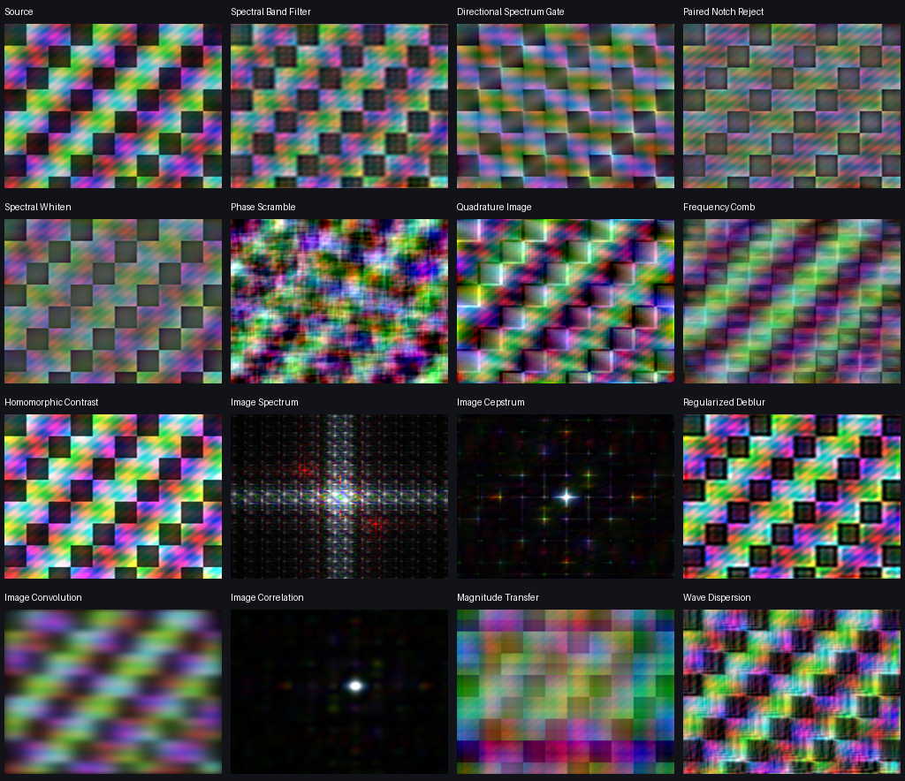

# Final 50 effect designs: batches 46–48

Build 32 continuation, November 17, 2026. This completes the implementation inventory from 850 to 900 definitions. It does **not** establish that 900 have passed GPU, visual or performance review. The runtime catalog/count test remains authoritative.

## Design scope

Each entry has its own operation, rather than being a renamed setting or a prebuilt stack. Related choices (pass/reject, RGB/alpha channels, address modes, stamp shapes) stay controls inside one definition. Existing effect cards and the existing reference-layer picker are reused. No transport, rig, graph or timeline layout is replaced.

| Family | Effect | Independent purpose |
| --- | --- | --- |
| 46 | Spectral Band Filter | Keep or reject a smooth radial frequency band, with separately editable inner and outer limits. |
| 46 | Directional Spectrum Gate | Attenuate a pair of frequency wedges to remove oriented image structure without blurring every direction. |
| 46 | Paired Notch Reject | Suppress a selected conjugate frequency pair, useful for periodic pattern removal or deliberate spectral holes. |
| 46 | Spectral Whiten | Reduce dominant spectral magnitudes relative to weak detail while retaining the original phase and mean. |
| 46 | Phase Scramble | Move image structure by scrambling conjugate phases while preserving frequency magnitudes. |
| 46 | Quadrature Image | Apply a directional Hilbert-style phase rotation to reveal quadrature structure rather than spatially shifting pixels. |
| 46 | Frequency Comb | Pass repeating radial frequency bands to produce coherent resonances and repeated image structure. |
| 46 | Homomorphic Contrast | Filter log-color illumination and detail separately, then exponentiate back into image space. |
| 46 | Image Spectrum | Inspect the centered Fourier magnitude or complex phase of the actual input image. |
| 46 | Image Cepstrum | Inverse-transform log magnitude to expose repeated spacing and image echoes as a new spatial field. |
| 46 | Regularized Deblur | Invert a Gaussian transfer function with a noise floor and bounded gain; this cannot recreate absent information. |
| 46 | Image Convolution | Use a reference layer as a normalized luminance kernel, with padded convolution and editable coverage. |
| 46 | Image Correlation | Cross-correlate two layers to display matching offsets, with phase whitening and peak smoothing. |
| 46 | Magnitude Transfer | Keep source phase while blending in a reference image's spectral magnitude; this transfers structure statistics rather than a color look. |
| 46 | Wave Dispersion | Apply an odd cubic spectral phase to disperse image features into coherent wave-like trails. |
| 47 | Channel Calculations | Calculate source and reference channels together, including signed arithmetic and alpha output. |
| 47 | UV Remap | Read absolute image coordinates from a reference RG map, rather than treating it as an offset. |
| 47 | Polar Map Displacement | Interpret reference red and green as radial and tangential displacements around an editable center. |
| 47 | Map Advection | Transport source pixels through a separate RG velocity field using midpoint integration. |
| 47 | Vector Map Smear | Integrate source colors along a curved reference vector path with independently controlled decay. |
| 47 | Height Map Refraction | A separate height layer refracts source channels through its gradients, with optical index and dispersion. |
| 47 | Compound Focus | A separate depth layer controls the local defocus radius around an editable focal depth. |
| 47 | Texture Bomb | Scatter cropped reference-image patches across the source with independent density, scale and rotation. |
| 47 | Local Color Match | Match local reference color and contrast while retaining source detail and coverage. |
| 47 | Detail Transfer | Combine source structure with a separately extracted reference detail band. |
| 47 | Map Dissolve | Reveal or remove the source through an arbitrary animated reference intensity map. |
| 47 | Matte Advection | Move only source coverage along a reference velocity field, keeping source color independent. |
| 47 | Normal Decal Light | Light source artwork using another layer's RGB normals, with separate diffuse, specular and ambient controls. |
| 47 | Depth Fog | Composite aerial haze according to an independent depth map, with near/far control. |
| 47 | Depth Parallax | March a view ray through a reference height field to find the visible source location, rather than applying a single offset. |
| 47 | Channel Pack | Replace one source channel with a selected reference channel, including correct alpha repremultiplication. |
| 47 | Image Registration | Estimate a dense source-to-reference alignment field and warp source pixels toward the matching image. |
| 47 | Depth Occlusion | Estimate local screen-space occlusion from a depth reference and shade the source without changing alpha. |
| 47 | Relief Cast Shadow | Trace toward a directional light through reference relief to cast self-shadow onto source artwork. |
| 47 | Palette Lookup | Use any row of a reference image as a continuous palette, with contrast, offset and addressing controls. |
| 48 | Tonal Stamp | Turn sampled image tone into editable stamp coverage, including shapes and colored paper. |
| 48 | Contour Stitch | Place short threads across the actual cutout boundary, oriented by its local normal. |
| 48 | Rope Fringe | Extend sampled boundary color into curved, tapered strands outside the cutout. |
| 48 | Paper Cut Layers | Quantized source-tone layers cast small directional shadows onto lower paper levels. |
| 48 | Lenticular Flip | Interlace source and reference through refracting strips with an editable viewing angle. |
| 48 | Sequin Image | Rebuild source color as separated, tilting reflective discs with actual coverage gaps. |
| 48 | Chord Art | Sample image darkness along bounded circular chords, then draw the resulting weighted line structure. |
| 48 | Junction Flares | Detect mixed-direction image corners and place glints there, instead of making every bright pixel sparkle. |
| 48 | Ink Flow Light | Image contours steer luminous ink trails through a local tangent field, with a separately softened halo. |
| 48 | Chromatic Edge Trails | Send independently oriented RGB edge energy into colored directional trails while retaining the source. |
| 48 | Relief Caustics | Curvature focuses and defocuses refracted source light using a protected local mapping Jacobian. |
| 48 | Prism Ink | Dark image strokes act as small spectral lenses, bending source channels and emitting a tight edge light. |
| 48 | Photo Collage | Reassemble local image patches as jittered paper photographs with borders, gaps and cast shadows. |
| 48 | Image Plexus | Image gradients displace graph nodes; connections inherit source color and respond to source intensity. |
| 48 | Contour Burn | Burn inward from the real cutout boundary, with a dark char band and independently softened ember light. |

## Controls and implementation

**46 — Spectral (15).** Float32 complex transforms reuse the bounded Poisson FFT implementation. Working resolution is 128/256/512 on the long side, default 256. Filters use paired frequencies; odd phase operations preserve conjugate symmetry and protect Nyquist lines. Source DC is retained where appropriate. Homomorphic processing operates on log color. Deblur has a noise floor and a maximum gain; it cannot recover information absent from the input. Convolution uses a twice-sized padded domain and a normalized reference-luminance kernel. Correlation is a diagnostic offset field, not a source-image look. Magnitude transfer changes source structure statistics while keeping its phase. Missing reference is a no-op.

**47 — Layer interaction (20).** These require a chosen reference layer. RG maps represent absolute coordinates or centered velocity depending on the named effect; RGB normal maps drive albedo lighting; depth controls focus, fog, parallax, occlusion and shadows. Transparent, clamp, repeat and mirror addressing are explicit on warps. Arithmetic and channel packing repremultiply alpha. Dense image registration uses the existing coarse-to-fine flow solver, not temporal frame substitution. Integration is capped at 16, smear/focus at 24, parallax at 32, occlusion at 32 taps and cast shadow at 16. Alignment is local image registration, not arbitrary camera/scene reconstruction.

**48 — Graphic craft (15).** Stamp coverage is driven by sampled image tone. Contour stitch, fringe and burn reuse the actual nearest-boundary field. Chords are bounded darkness-weighted line integrals, not a claim of globally optimized string art. Junction flares use a local gradient tensor; Image Plexus uses source gradients and sampled color. Caustics use a protected refraction Jacobian. Ink light and chromatic trails are bounded source-edge integrations. Lenticular strips use the selected second image. Light passes cap their working long side at 1024 and upscale before the existing composite. Chord count caps at 48; detection grids cap at 256/512. Whole-image light generation does not run a feature search per output pixel.

Burn has 0–1000 px travel for large layers. Its moving review uses 0–35 px so a small fixture shows the advancing edge instead of spending nearly the entire animation empty. Endpoint tests still cover maximum consumption. The direct numeric test uses 0/18 px for the same reason. Pattern cells are anchored to the original layer extent so adding glow padding does not move the design.

## Research used

- Adobe, [Channel effects](https://helpx.adobe.com/after-effects/desktop/apply-effects-and-animation-presets/list-of-effects/channel-effects.html): channel arithmetic and output semantics.
- Boris FX, [Emboss Distort](https://borisfx.com/documentation/sapphire/ofx/embossdistort/) and [effect index](https://borisfx.com/documentation/sapphire/ofx/summary-index/): independent source/reference roles and relief controls.
- FFTW, [real-data transforms](https://fftw.org/fftw3_doc/The-1d-Real_002ddata-DFT.html) and [multidimensional transforms](https://www.fftw.org/doc/Multi_002ddimensional_Transforms.html): Hermitian symmetry, Nyquist constraints and inverse normalization.
- scikit-image, [deconvolution example](https://scikit-image.org/docs/stable/auto_examples/filters/plot_restoration.html): regularization and noise amplification.
- The owner-provided local AE Motion 2.5 IPA was read as a ZIP. 671 non-quarantine BuiltinEffects XML metadata files were inventoried. Selected metadata included NormalMap, Luma Stamper+, GradientDisplace, PolytraceSampler, PlexusTriangle and GlowRibbon. This was parameter/interaction research: no executable, shader, texture or proprietary implementation was copied. Baked-overlay combinations were not imported.

## Evidence and remaining gates

Local checks: all Swift sources parse; 50 distinct new IDs/names and contiguous modes; seven new Metal entry points appear in the kernel registry; patch whitespace checks pass. The standalone NumPy oracle checks real inverse output, Hilbert phase sign/DC, normalized convolution energy, and finite spectral defaults. It is independent CPU math, not a shader test.

The sheet was inspected. Defaults were retuned: deblur sigma 1.5 / maximum gain 3 / noise floor .05, homomorphic low .85 / detail 1.2, dispersion 8, cepstrum response 100; spectrum magnitudes use a readable display scale. The reproducible script also produces a moving CPU design GIF under build_out/spectral46. Those outputs do not prove parity with Metal.

`Expansion50EffectTests` adds intended-source/reference fixtures, distinctness and browser placement, visible defaults, exact Blend=0, missing-reference bypass, imported missing-parameter fallback, reference-control response, burn/dissolve endpoints, direct channel/alpha arithmetic, absolute UV identity, constant vector transport and a known quadrature sine oracle. Existing generic control tests retain coverage of non-reference effects. No new no-op exemptions were introduced.

All three families are included in the app contact sheets and every-effect 30-frame moving render manifest. The combined validation run must compile Metal, execute these tests plus the existing suite, and produce the actual artifacts. Inspect contact sheets, moving renders and ui-screenshots, retune/fix failures, then package a release. No green GPU result, UI review or phone 60 fps guarantee is claimed by this implementation checkpoint.

Presets follow effects acceptance; final performance follows presets; AI cutout/training remains paused.
